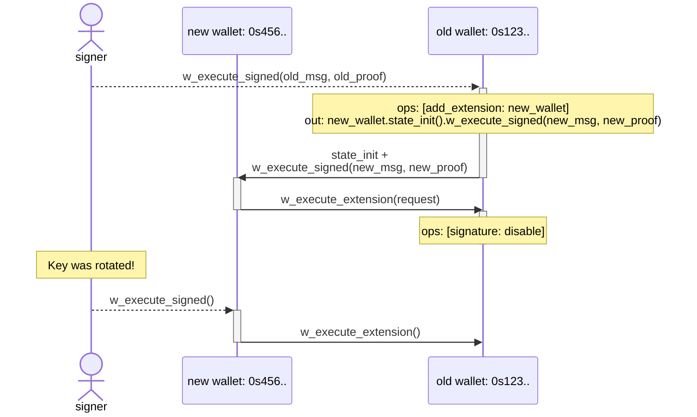

# Wallet Contract

A generic minimalistic wallet smart-contract that enables for true *sharded* and
*extendable* **account abstraction** on Near Protocol.

> **WARN:** This implementation has not been audited yet. **DO NOT** store any
> significant funds on it.

## Key Features

* Execute *arbitrary* [**promises**](#promises) (i.e. cross-contract calls).
* [**Extensions**](#extensions) can be implemented as *separate* third-party
  accounts/contracts on Near with their own arbitrary logic. Installed
  extensions have full control over the wallet-contract instance and can be
  added/removed by the signer or other installed extensions. Enables 2FA, social
  recovery and more.
* Can support *any* [**signing standards**](#signing-standards). As of now, we
  have support for **passkeys** (both `p256` and `ed25519`). Additional variants
  can be implemented by *anyone* in the future.
* **Non-sequential** timeout-based [nonces](#nonces) enable *concurrent* request
  and avoid head-of-line blocking.
* `AccountIds` are [deterministically derived](https://github.com/near/NEPs/blob/master/neps/nep-0616.md#deterministic-accountids)
  from wallet initialization state (i.e. public key), so wallet address is known
  even *prior* to the first on-chain interaction. This enables truly **sharded**
  and **composable** on-chain interactions with **no factory** needed.
* Multiple **sub-wallets** can be derived for a single public key by specifying
  different `subwallet_id`s.
* **Zero Balance Accounts**: optimized to fit within [NEP-448](https://github.com/near/NEPs/blob/master/neps/nep-0448.md)
  ZBA limits (770 bytes), so wallets can be created *without* acquiring NEAR
  first.
* [Global Contract](https://github.com/near/NEPs/blob/master/neps/nep-0591.md)
  can be *optionally* **upgradable**  via [Global Deployer](../global-deployer/README.md).

## Architecture

A wallet contract has two main entrypoints for executing requests:

* **Signed requests** via `w_execute_signed(msg, proof)`: the signer constructs
  a `request`, wraps in into a signable message, signs it according to the
  wallet's signing standard, and submits it along with the proof via a
  (permissionless) relayer. The contract verifies chain id, signer id, nonce,
  and signature before execution.
* **Extension requests** via `w_execute_extension(request)`: allowed only for
  enabled extensions, no signature is required.

Each `request` contains:

* `internal`: *(optional)* list of wallet operations: enable/disable signature,
  add/remove extension, require token metadata (see
  [token metadata checks](#token-metadata-checks))
* `external`: *(optional)* promises (i.e. cross-contract calls) to execute.

Signed request and NEP-641 messages, the authorization envelope and the
arguments of `w_execute_signed`, `w_execute_extension` and `w_resolve_auth`
reject JSON fields that the contract does not define, and state init rejects
duplicate storage keys, so nothing is silently ignored. Absent optional
fields take their defaults; `null` is accepted only for `refund_to`. Values
are parsed before they are signed or shown, so non-canonical forms (e.g. the
amount `"01"`, a timestamp with an offset, unpadded base64) stand for their
canonical value. Requests must omit fields that the contract does not define.

### Signing Standards

The [Sui variants](signatures/sui/README.md) reuse the readable message renderer
and verify native Sui personal-message signatures. Separate Ed25519, secp256k1
and P-256 (Sui secp256r1) contracts each accept one scheme and have their own
global contract IDs; their common parent is a reusable library.

A single wallet-contract variant supports only a single signing standard, which
is fixed at the time of a deployment. Each variant is deployed as a
**separate** global contract.

A public key of the wallet contract instance is also fixed at the time of first
initialization and **cannot** be changed later. However, signature can still be
disabled by signer/extension (see [key rotation](#key-rotation)).

The readable v1 signing format used by the Sui variants is implemented in this
crate's `readable_message` module, behind the opt-in `readable-message` feature,
so other variants do not include it. Each variant that uses it supplies its own
identity fields, such as the Sui public key and address.
Fields have a fixed order, with wallet operations before external
calls; each `add_extension` adds a warning line, and a request passed to
another wallet's `w_execute_extension()` is shown by the same rules.

### Extensions

Extensions are **separate** third-party accounts/contracts on Near that can
execute arbitrary requests on behalf of the wallet and have the same full power
over the wallet-contract instance as the original signer does. Extensions can be
added or removed by the signer or other installed extensions.

Extensions is an *open ecosystem* which enable patterns like 2FA, social
recovery, spending limits, session keys, etc.

#### Lockout protection

The contract prevents disabling all authentication methods at once: if signature
is disabled, then at least one extensions must remain enabled. Otherwise, the
whole request fails.

### Nonces

Wallet contract implements **non-sequential** double-timeout window nonces for
replay protection, enabling *concurrent* request submission from multiple
*non-coordinated* applications.

* Each signed request message includes a 32-bit `msg.nonce`, `msg.created_at`
  and a corresponding `msg.timeout` which is the *maximum* validity of this
  nonce after `msg.created_at`.
* At the same time, wallet-contract has its own [`wallet.timeout`](#timeout-selection).
* A signed request with given `msg.nonce` is considered valid between
  `msg.created_at` and `msg.created_at + min(msg.timeout, wallet.timeout)`.

Nonces are rotated every `wallet.timeout` and cleaned up after at most
`2 * wallet.timeout`, meaning that each nonce can be safely re-used only after
at least `2 * wallet.timeout`. Otherwise, if the nonce is re-used too early, the
corresponding signed request will fail.

> **NOTE**: The contract ensures that `now() - timeout <= created_at <= now()`,
> where `now()` is the current block timestamp. Due to the desentralized nature
> of consensus in blockchains, block timestamps usually lag a bit behind the
> actual time when it's produced. As a result, signers are recommended to set
> `created_at` slightly (e.g. 60 seconds) before the actual time of signing, so
> that it doesn't fail on-chain if it arrives too fast.

A signed request whose execution fails (for example, its deposits exceed the
balance) is rolled back with its receipt, so its nonce stays unused: anyone
who saw the failed transaction can submit the same request again until it
expires. To retry, resubmit that request or sign the new one with the same
nonce, so that at most one of them executes, or wait until it expires.

#### Optimal nonce generation algorithm

Despite nonces are stored efficiently and cleaned up every `2 * timeout`, it's
still important to generate them efficiently to reduce the storage usage. The
more sequential nonces are, the less space they consume.

* For a **single** signer, it's recommended to generate nonces *incrementally*:
  
  ```rust,ignore
  let nonce = self.next_nonce;
  self.next_nonce += 1;
  ```

* For *concurrent* **non-coordinated** signers (e.g. when a user might sign two
  requests concurrently with the same key from different devices), it's
  recommended to generate nonces *semi-sequentially*, i.e. where the nonce is randomized after each 32 sequential ones:

  ```rust,ignore
  const BIT_POS_MASK: u32 = 0b11111;

  if self.next_nonce & BIT_POS_MASK == 0 {
      self.next_nonce = random_u32() & !BIT_POS_MASK;
  }

  let nonce = self.next_nonce;
  self.next_nonce += 1;
  ```

#### Timeout selection

Wallet's `wallet.timeout` is fixed at the time of initialization and **cannot**
be changed afterwards. Nonces are cleaned up every `2 * wallet.timeout`. The
longer the timeout, the more storage usage in highload environments.

Recommended timeout for production use is `1 hour`.

### Subwallets

A single public key can control multiple wallet contracts by varying the `subwallet_id` field in the initialization state. Each subwallet has a distinct deterministic `AccountId`.

### Promises

Requests can optionally include arbitrary number of promises (i.e. cross-contract calls), each one with one or more actions.

All created promises are executed concurrently and independently of each other,
without waiting on previous ones to complete

A promise's `refund_to` (by default the wallet) receives its failed and unused
deposits, including the unused part of a `StateInit` budget. Readable signing
formats warn when it is another account and the promise attaches NEAR.

A function call with `gas` 0 (the default) gets only the gas left from what the
relayer attached, shared by `gas_weight`, so the relayer can make it fail while
other promises succeed. Set `gas` for calls that must not depend on the relayer.

Supported actions within promises are:

| Action | Description |
| -------- | ------------- |
| `FunctionCall` | Call a contract method |
| `Transfer` | Send NEAR tokens |
| `StateInit` | Deploy a new contract at a [deterministic AccountId](https://github.com/near/NEPs/blob/master/neps/nep-0616.md) |

#### `StateInit` storage deposit and funding

`StateInit.deposit` is a refundable storage budget, not a transfer of the full
amount to the new account. At that action, the runtime retains only the balance
missing for the account's current storage requirement and refunds the rest to
`refund_to` (or the wallet if unset). For a zero-balance account it can refund the
entire deposit. See the [NEAR runtime's deposit settlement](https://github.com/near/nearcore/blob/2.14.0/runtime/runtime/src/deterministic_account_id.rs).

Storage written by a later function call is not covered by an already-refunded
`StateInit` deposit. Fund that storage separately, for example with an explicit
`Transfer` between `StateInit` and the initializing call in the same promise.
The readable message binds both actions and the refund target; the wallet does
not convert a storage deposit into a transfer.

For security reasons, self-calls are **not** supported.

Other actions (e.g. `DeployContract`, `AddKey`, etc.) are intentionally **not**
supported: wallet contracts are not self-upgradable and do not allow creating
subaccounts.

### Token metadata checks

The `require_ft_metadata` operation names a token and its expected NEP-148
`decimals` and `symbol`. Promises of the same request to that token are created
only after the token's `ft_metadata()` returns exactly these values: the wallet
calls `ft_metadata()` and creates the promise in its private
`w_on_ft_metadata()` callback. If the values differ, the call fails or the
result exceeds 32 KiB, the promise is not created and the request's nonce stays
used. A request may require metadata of each token at most once. Only
promises to that token wait for the check: the request's wallet operations
and other promises take effect whatever its result. Formats that require the
check for NEP-141 transfers cannot transfer a token whose `ft_metadata()`
fails, exceeds 32 KiB or needs more than 5 Tgas; an extension still can.

Each checked promise costs two more receipts. The wallet reserves 5 Tgas for
`ft_metadata()` and 10 Tgas for the callback in addition to the promise's own
gas; `Request::estimate_gas()` includes both. Unused gas is shared as without the
check: `ft_metadata()` gets none, and the callback gets the total `gas_weight` of
the promise's function calls.

For each checked promise, the sum of its call weights must fit `u64`. An overflow
rejects the request instead of changing the gas shares. The failed receipt
persists no wallet operations, nonce commitment or outgoing promises. Unchecked
promises retain the runtime's native weight semantics.
This bound is enforced during execution, not when constructing a signing message.

The check runs before the whole promise. A promise that itself creates the token
(`StateInit` and initialization) therefore fails the check, and nothing is
created. Create and initialize the token in an earlier request, then transfer.

The readable signing format uses these values to show NEP-141 transfer amounts
with decimals and symbol.

## Example flows

### Key rotation

Despite wallet contract does not support key rotation by itself due to its
design philosophy, it's still possible to implement key rotation via extensions
while keeping the original address.

To rotate a key for the original wallet, the signer needs to:

1. Create a new keypair
1. Derive a new wallet address from the new public key
1. Prepare a request for the new wallet that calls `w_execute_extension()` method
   on the old wallet and disables signature on it, and sign it by the new key.
1. Prepare another request for the old wallet that adds the new wallet as an
   extension, initializes its state and calls `w_execute_signed()` method on it,
   passing there the request and the corresponding proof from the previous step.
1. Sign the nested request by the old key and relay it to the old wallet.

As a result, signer can now sign by the new key extension requests to the old
wallet, while having a full control over the original address.


