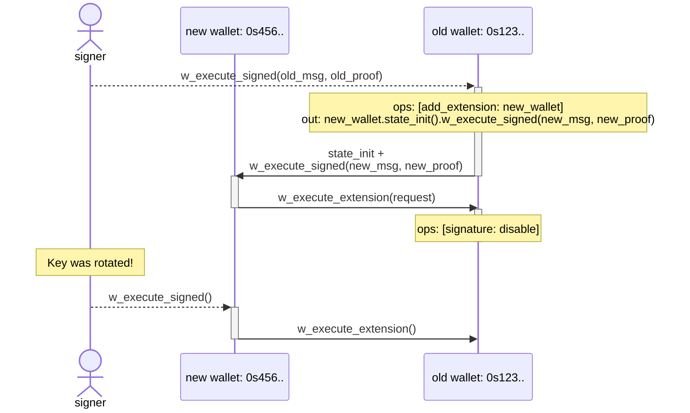

# Wallet Contract

A generic minimalistic wallet smart-contract that enables for true *sharded* and
*extendable* **account abstraction** on Near Protocol.

> **WARN:** This implementation has not been audited yet. **DO NOT** store any
> significant funds on it.

## Key Features

* Execute *arbitrary* [**promises**](#promises) (i.e. cross-contract calls).
* [**Extensions**](#extensions) can be implemented as *separate* third-party
  accounts/contracts on Near with their own arbitrary logic. Installed
  extensions have full control over the wallet-contract instance and can be
  added/removed by the signer or other installed extensions. Enables 2FA, social
  recovery and more.
* Can support *any* [**signing standards**](#signing-standards). As of now, we
  have support for **passkeys** (both `p256` and `ed25519`). Additional variants
  can be implemented by *anyone* in the future.
* **Non-sequential** timeout-based [nonces](#nonces) enable *concurrent* request
  and avoid head-of-line blocking.
* `AccountIds` are [deterministically derived](https://github.com/near/NEPs/blob/master/neps/nep-0616.md#deterministic-accountids)
  from wallet initialization state (i.e. public key), so wallet address is known
  even *prior* to the first on-chain interaction. This enables truly **sharded**
  and **composable** on-chain interactions with **no factory** needed.
* Multiple **sub-wallets** can be derived for a single public key by specifying
  different `subwallet_id`s.
* **Zero Balance Accounts**: optimized to fit within [NEP-448](https://github.com/near/NEPs/blob/master/neps/nep-0448.md)
  ZBA limits (770 bytes), so wallets can be created *without* acquiring NEAR
  first.
* [Global Contract](https://github.com/near/NEPs/blob/master/neps/nep-0591.md)
  can be *optionally* **upgradable**  via [Global Deployer](../global-deployer/README.md).

## Architecture

A wallet contract has two main entrypoints for executing requests:

* **Signed requests** via `w_execute_signed(msg, proof)`: the signer constructs
  a `request`, wraps in into a signable message, signs it according to the
  wallet's signing standard, and submits it along with the proof via a
  (permissionless) relayer. The contract verifies chain id, signer id, nonce,
  and signature before execution.
* **Extension requests** via `w_execute_extension(request)`: allowed only for
  enabled extensions, no signature is required.

Each `request` contains:

* `internal`: *(optional)* list of wallet operations: enable/disable signature,
  add/remove extension, require token metadata (see
  [token metadata checks](#token-metadata-checks))
* `external`: *(optional)* promises (i.e. cross-contract calls) to execute.

Signed request and NEP-641 messages, the authorization envelope and the
arguments of `w_execute_signed`, `w_execute_extension` and `w_resolve_auth`
reject JSON fields that the contract does not define, and state init rejects
duplicate storage keys, so nothing is silently ignored. Absent optional
fields take their defaults; `null` is accepted only for `refund_to`. Values
are parsed before they are signed or shown, so non-canonical forms (e.g. the
amount `"01"`, a timestamp with an offset, unpadded base64) stand for their
canonical value. Requests must omit fields that the contract does not define.

### Signing Standards

The [Sui variants](signatures/sui/README.md) reuse the readable message renderer
and verify native Sui personal-message signatures. Separate Ed25519, secp256k1
and P-256 (Sui secp256r1) contracts each accept one scheme and have their own
global contract IDs; their common parent is a reusable library.

A single wallet-contract variant supports only a single signing standard, which
is fixed at the time of a deployment. Each variant is deployed as a
**separate** global contract.

A public key of the wallet contract instance is also fixed at the time of first
initialization and **cannot** be changed later. However, signature can still be
disabled by signer/extension (see [key rotation](#key-rotation)).

Variants that sign human-readable text share the
[readable signing format](#readable-signing-format-v1).

### Readable signing format (v1)

Variants that sign human-readable text share one format, implemented in this
crate's `readable_message` module behind the opt-in `readable-message` feature.
The contract rebuilds the text from the parsed message and the stored identity
and verifies the signature over exactly these bytes, so no text, summary or
digest supplied by a dApp is trusted. Each variant defines its identity fields
and signature envelope.

A message is a prefix, warning lines (if any), a JSON document and a final LF.
It is ASCII and at most 16 KiB (16384 bytes).

**Prefix** of an execution request (each line ends with LF, then one empty
line):

```text
NEAR Wallet Contract: execute request (v1)
This signature authorizes NEAR wallet operations, not a login.
Gas is in gas units.
Function arguments and deployment state may be opaque: verify them before signing.
```

and of a NEP-641 authorization:

```text
NEAR Wallet Contract: offchain authorization (v1)
This signature authorizes the exact payload below, not a NEAR transaction.
The consuming application defines expiration and one-time-use requirements.
```

**Warnings** of an execution request follow its prefix, one per line, then one
empty line. For each request, its `add_extension` operations come first, then
its promises in order:

- `WARNING: add_extension gives <account> full control of <wallet>.`
- `WARNING: up to <amount> sent to <receiver> can be refunded to <refund_to>, not to <wallet>.`
  for a promise that attaches NEAR (transfers and deposits) and whose
  `refund_to` is another account than the executing wallet.

`<wallet>` is `this wallet`, or `wallet <account>` for a nested request.

**JSON** is indented with two spaces, with `": "` after keys. Every UTF-16
code unit from U+007F upward is escaped as lowercase `\uXXXX`. Arrays keep
their order, and fields have a fixed order:

- execution request: `chain_id`, `signer_id`, the identity fields, `nonce`,
  `created_at`, `timeout_secs`, `pay_for_gas`, `request`;
- NEP-641 authorization: `chain_id`, `signer_id`, the identity fields, `path`,
  `timestamp`, `payload`. The payload is an exact string and is never parsed;
- `request`: `internal` (wallet operations in their JSON form), then
  `external` (promises);
- promise: `receiver_id`, `refund_to` (`null` is the executing wallet),
  `actions`;
- action: `action`, then `amount` for `transfer`; `function_name`, `deposit`,
  `gas`, `gas_weight`, `args` for `function_call`; `deposit`, `state_init`
  (object keys sorted as strings) for `deterministic_state_init`.

Values:

- Defaults are shown: `pay_for_gas` `false`, `refund_to` `null`, deposit
  `"0 NEAR"`, `gas` `"0"`, `gas_weight` `"1"`.
- NEAR amounts have 24 decimals without trailing zeros and the `NEAR` symbol,
  e.g. `1.5 NEAR`.
- `nonce`, `timeout_secs` and `decimals` are numbers; `gas` and `gas_weight`
  are decimal strings.
- Timestamps are RFC 3339 in UTC with `Z` and up to nine fractional digits
  without trailing zeros, e.g. `2026-11-03T12:34:56.12Z`. They must fit
  unsigned 64-bit Unix nanoseconds; the timeout is whole seconds fitting `u32`.

Function calls:

- `args` is shown once, as JSON in its original key order. The arguments must
  be exactly the compact serialization of that JSON, the same in
  `serde_json::to_vec` and `JSON.stringify`, so the text determines their
  bytes: no whitespace, duplicate keys, optional escapes or alternative number
  forms; integers within ±(2^53 - 1); no unpaired surrogates; integer keys
  (`"0"` to `"4294967294"`) first in ascending order. Empty and binary
  arguments are rejected; call a method without parameters with `{}`.
- NEP-141 `ft_transfer` and `ft_transfer_call` need one `require_ft_metadata`
  operation for their token in the same request (see
  [token metadata checks](#token-metadata-checks)). `args.amount` must be a
  decimal `u128` string without leading zeros and is shown with the required
  decimals and symbol, e.g. `1.5 USDC`. Only the method's parameters are
  accepted (`receiver_id`, `amount`, `memo`, and `msg` for `ft_transfer_call`).
- A call of another wallet's `w_execute_extension` (this wallet as its
  extension) shows the nested `request` by the same rules, with its own
  warnings and metadata requirements. The arguments must be exactly the serde
  form of that request (the contract's field order, defaults omitted).

Before rendering, raw function-call arguments (a nested request counts with
its base64 encoding), state data, token symbols and 64 bytes per operation,
promise and action must fit 16 KiB. JSON arguments nest at most 127 levels.

What the text does not decode:

- JSON inside a string value (such as `msg` of `ft_transfer_call`) stays an
  escaped string, and a nested `w_execute_signed` shows its inner arguments as
  base64.
- Amounts in arguments of other methods (e.g. NEP-245 `mt_transfer`) are in
  base units.
- `deterministic_state_init` data is base64 keys and values.
- Method names and text inside `args` come from the dApp and may imitate
  contract-written parts. Only warning lines, amounts outside `args` and
  NEP-141 transfer amounts are written by the contract.
- A token symbol is the token's own text (a symbol `000 USDC` makes one unit
  read `1 000 USDC`); it identifies the token only together with the receiver
  account.
- A shown call says nothing about the called contract's behavior.

### Verify control before funding

Deriving an account ID does not prove that anyone can sign for it. Before
showing a derived account as a deposit destination, have the user sign a
NEP-641 message with the selected variant and verify it. Bind it to the
network, the account and a fresh random value; it must not authorize anything
else. A connected address or public key alone is not enough.

### Extensions

Extensions are **separate** third-party accounts/contracts on Near that can
execute arbitrary requests on behalf of the wallet and have the same full power
over the wallet-contract instance as the original signer does. Extensions can be
added or removed by the signer or other installed extensions.

Extensions is an *open ecosystem* which enable patterns like 2FA, social
recovery, spending limits, session keys, etc.

#### Lockout protection

The contract prevents disabling all authentication methods at once: if signature
is disabled, then at least one extensions must remain enabled. Otherwise, the
whole request fails.

### Nonces

Wallet contract implements **non-sequential** double-timeout window nonces for
replay protection, enabling *concurrent* request submission from multiple
*non-coordinated* applications.

* Each signed request message includes a 32-bit `msg.nonce`, `msg.created_at`
  and a corresponding `msg.timeout` which is the *maximum* validity of this
  nonce after `msg.created_at`.
* At the same time, wallet-contract has its own [`wallet.timeout`](#timeout-selection).
* A signed request with given `msg.nonce` is considered valid between
  `msg.created_at` and `msg.created_at + min(msg.timeout, wallet.timeout)`.

Nonces are rotated every `wallet.timeout` and cleaned up after at most
`2 * wallet.timeout`, meaning that each nonce can be safely re-used only after
at least `2 * wallet.timeout`. Otherwise, if the nonce is re-used too early, the
corresponding signed request will fail.

> **NOTE**: The contract ensures that `now() - timeout <= created_at <= now()`,
> where `now()` is the current block timestamp. Due to the desentralized nature
> of consensus in blockchains, block timestamps usually lag a bit behind the
> actual time when it's produced. As a result, signers are recommended to set
> `created_at` slightly (e.g. 60 seconds) before the actual time of signing, so
> that it doesn't fail on-chain if it arrives too fast.

If the `w_execute_signed()` receipt fails (for example, the promises it
creates attach more NEAR than the wallet holds), it is rolled back, so the
request's nonce stays unused: anyone who saw the failed transaction can submit
the same request again until it expires. To retry, resubmit that request or
sign the new one with the same nonce, so that at most one of them executes, or
wait until it expires. Later receipts do not roll it back: if a created
promise, an `ft_metadata()` check or its callback fails (for example, a checked
promise attaches more NEAR than the wallet holds when the callback creates
it), the nonce stays used and the request cannot be executed again.

#### Optimal nonce generation algorithm

Despite nonces are stored efficiently and cleaned up every `2 * timeout`, it's
still important to generate them efficiently to reduce the storage usage. The
more sequential nonces are, the less space they consume.

* For a **single** signer, it's recommended to generate nonces *incrementally*:
  
  ```rust,ignore
  let nonce = self.next_nonce;
  self.next_nonce += 1;
  ```

* For *concurrent* **non-coordinated** signers (e.g. when a user might sign two
  requests concurrently with the same key from different devices), it's
  recommended to generate nonces *semi-sequentially*, i.e. where the nonce is randomized after each 32 sequential ones:

  ```rust,ignore
  const BIT_POS_MASK: u32 = 0b11111;

  if self.next_nonce & BIT_POS_MASK == 0 {
      self.next_nonce = random_u32() & !BIT_POS_MASK;
  }

  let nonce = self.next_nonce;
  self.next_nonce += 1;
  ```

#### Timeout selection

Wallet's `wallet.timeout` is fixed at the time of initialization and **cannot**
be changed afterwards. Nonces are cleaned up every `2 * wallet.timeout`. The
longer the timeout, the more storage usage in highload environments.

Recommended timeout for production use is `1 hour`.

### Subwallets

A single public key can control multiple wallet contracts by varying the `subwallet_id` field in the initialization state. Each subwallet has a distinct deterministic `AccountId`.

### Promises

Requests can optionally include arbitrary number of promises (i.e. cross-contract calls), each one with one or more actions.

All created promises are executed concurrently and independently of each other,
without waiting on previous ones to complete

A promise's `refund_to` (by default the wallet) receives its failed and unused
deposits, including the unused part of a `StateInit` budget. Readable signing
formats warn when it is another account and the promise attaches NEAR.

A function call with `gas` 0 (the default) gets only the gas left from what the
relayer attached, shared by `gas_weight`, so the relayer can make it fail while
other promises succeed. Set `gas` for calls that must not depend on the relayer.

Supported actions within promises are:

| Action | Description |
| -------- | ------------- |
| `FunctionCall` | Call a contract method |
| `Transfer` | Send NEAR tokens |
| `StateInit` | Deploy a new contract at a [deterministic AccountId](https://github.com/near/NEPs/blob/master/neps/nep-0616.md) |

#### `StateInit` storage deposit and funding

`StateInit.deposit` is a refundable storage budget, not a transfer of the full
amount to the new account. At that action, the runtime retains only the balance
missing for the account's current storage requirement and refunds the rest to
`refund_to` (or the wallet if unset). For a zero-balance account it can refund the
entire deposit. See the [NEAR runtime's deposit settlement](https://github.com/near/nearcore/blob/2.14.0/runtime/runtime/src/deterministic_account_id.rs).

Storage written by a later function call is not covered by an already-refunded
`StateInit` deposit. Fund that storage separately, for example with an explicit
`Transfer` between `StateInit` and the initializing call in the same promise.
The readable message binds both actions and the refund target; the wallet does
not convert a storage deposit into a transfer.

For security reasons, self-calls are **not** supported.

Other actions (e.g. `DeployContract`, `AddKey`, etc.) are intentionally **not**
supported: wallet contracts are not self-upgradable and do not allow creating
subaccounts.

### Token metadata checks

The `require_ft_metadata` operation names a token and its expected NEP-148
`decimals` and `symbol`. Promises of the same request to that token are created
only after the token's `ft_metadata()` returns exactly these values: the wallet
calls `ft_metadata()` and creates the promise in its private
`w_on_ft_metadata()` callback. The readable signing format requires the
operation for NEP-141 transfers and shows their amounts with these values.

- A request may require metadata of each token at most once.
- If the values differ, the call fails, or the response is malformed or larger
  than 32 KiB, the promise is not created. The request's nonce stays used, and
  its wallet operations and other promises are not rolled back.
- The check runs before the whole promise, so a promise that itself creates
  the token (`StateInit` and initialization) fails it. Create and initialize
  the token in an earlier request.
- Each checked promise costs two more receipts. The wallet reserves 10 Tgas
  for `ft_metadata()` and 10 Tgas for the callback in addition to the
  promise's own gas. `ft_metadata()` gets no unused gas; the callback gets the
  sum of the promise's call `gas_weight` values, which must fit `u64`
  (otherwise the request is rejected during execution and nothing is
  persisted).
- `Request::estimate_gas()` includes these reserves and the creation of both
  calls. It does not cover signature verification of long messages or large
  callback arguments, so relayers must leave headroom.

Limitations:

- A token whose `ft_metadata()` response exceeds 32 KiB (an embedded icon
  counts) or needs more than 10 Tgas cannot be transferred by a
  readable-format signature. Check a token before accepting deposits of it. An
  enabled extension that uses another authorization format can transfer it
  without the check; a readable-format wallet acting as an extension cannot,
  because its nested request needs the same operation.
- A wallet deployed from code that predates this operation rejects requests
  containing it. A readable-format wallet acting as an extension of such a
  wallet cannot make NEP-141 transfers from it; it can still add another
  extension or re-enable that wallet's own signature.

## Example flows

### Key rotation

Despite wallet contract does not support key rotation by itself due to its
design philosophy, it's still possible to implement key rotation via extensions
while keeping the original address.

To rotate a key for the original wallet, the signer needs to:

1. Create a new keypair
1. Derive a new wallet address from the new public key
1. Prepare a request for the new wallet that calls `w_execute_extension()` method
   on the old wallet and disables signature on it, and sign it by the new key.
1. Prepare another request for the old wallet that adds the new wallet as an
   extension, initializes its state and calls `w_execute_signed()` method on it,
   passing there the request and the corresponding proof from the previous step.
1. Sign the nested request by the old key and relay it to the old wallet.

As a result, signer can now sign by the new key extension requests to the old
wallet, while having a full control over the original address.


